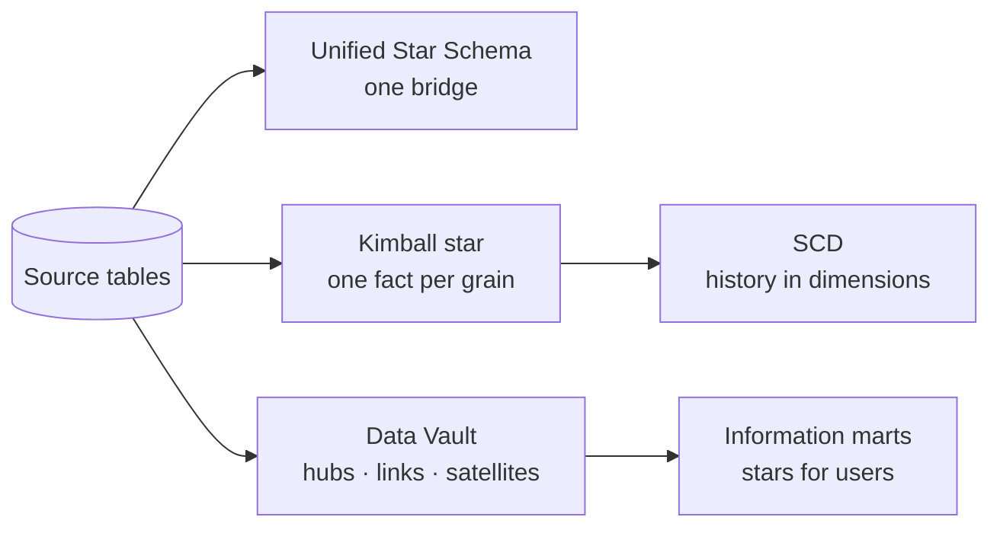

# data-modelling-basics

[](https://github.com/enricoconvento98/data-modelling-basics/actions/workflows/ci.yml)
[](https://enricoconvento98.github.io/data-modelling-basics/)


A hands-on guide to four data modelling patterns, each with an explanation,
diagrams, runnable SQL, and a tested dbt implementation.

**[Open the visual guide →](https://enricoconvento98.github.io/data-modelling-basics/)**
&nbsp;·&nbsp; **[dbt docs and lineage graph →](https://enricoconvento98.github.io/data-modelling-basics/dbt-docs/)**

## The problem every pattern solves

All topics use the same tiny shop: **one customer, one order (freight 10) with
three lines (amount 100), two shipments (ship cost 12)**, and a product nobody
bought. Joining these tables naively gives the wrong totals:

| Query | freight | amount | ship_cost |
|-------|--:|--:|--:|
| orders ⋈ order_lines (fan trap) | **30** ❌ | 100 | |
| customers ⋈ orders ⋈ shipments (chasm trap) | **20** ❌ | | 12 |
| all four tables together | **60** ❌ | **200** ❌ | **36** ❌ |
| **any of the patterns below** | **10** ✅ | **100** ✅ | **12** ✅ |

## Topics

| # | Topic | What you learn |
|---|-------|----------------|
| 1 | [Unified Star Schema](unified-star-schema/README.md) | Fan and chasm traps; the Puppini Bridge; every table joins only to `_bridge` (Puppini & Inmon) |
| 2 | [Kimball Star Schema](kimball-star-schema/README.md) | Facts, dimensions and grain; allocation; drill-across with conformed dimensions; comparison with USS |
| 3 | [Slowly Changing Dimensions](slowly-changing-dimensions/README.md) | SCD types 0, 1, 2, 3 and 6; point-in-time fact lookup; incremental Type 2 merge |
| 4 | [Data Vault 2.0](data-vault/README.md) | Hubs, links and satellites; hash keys and hash diffs; idempotent insert-only loads; information marts |
| ★ | [dbt project](dbt-project/README.md) | All four as a production-style pipeline: layers, incremental models, snapshots, 120+ tests |

Topics 1 and 2 use the same source data, so the two approaches can be compared
side by side. Topic 4 shows how the history of topic 3 comes for free in a
Data Vault.



## Quick start

**Plain SQL** (each topic folder):

```sh
cd unified-star-schema
./run.sh              # DuckDB CLI, in-memory
./run.sh --postgres   # PostgreSQL via psql (uses PGHOST, PGUSER, ...)
```

**dbt** (all topics, with tests):

```sh
cd dbt-project
python -m venv .venv && source .venv/bin/activate
pip install -r requirements.txt
./run_dbt.sh                                   # 3 simulated daily runs, 181 checks each
dbt docs generate --profiles-dir . && dbt docs serve --profiles-dir .
```

## Repository layout

```
.
├── unified-star-schema/        README + sql/ + run.sh
├── kimball-star-schema/        README + sql/ + run.sh
├── slowly-changing-dimensions/ README + sql/ + run.sh
├── data-vault/                 README + sql/ + run.sh
├── dbt-project/                dbt Core + DuckDB: seeds, models, snapshots, tests
├── site/                       GitHub Pages home page (visual guide)
└── .github/workflows/
    ├── ci.yml                  SQL on DuckDB + PostgreSQL, dbt build + tests
    └── pages.yml               builds dbt docs and deploys the site
```

## Tech stack

| Area | Tools |
|------|-------|
| Modelling | Unified Star Schema, Kimball dimensional modelling, SCD, Data Vault 2.0 |
| SQL engines | DuckDB, PostgreSQL |
| Transformation | dbt Core 1.12 + dbt-duckdb: incremental models, snapshots, macros, unit tests, custom generic tests |
| CI/CD | GitHub Actions: tests on every push, docs site deployed to GitHub Pages |
| Docs | Markdown + Mermaid diagrams, dbt docs |

## Continuous integration

Every push runs [`ci.yml`](.github/workflows/ci.yml):

- **SQL examples**: every topic on DuckDB and on a PostgreSQL 16 service container.
- **dbt**: three simulated daily runs (including an idempotent re-run of the
  same extract), each executing 3 unit tests and 119 data tests.

Every push to `main` also runs [`pages.yml`](.github/workflows/pages.yml),
which rebuilds the dbt docs and publishes the site.
