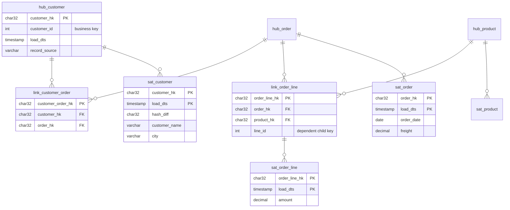

# Data Vault 2.0

Data Vault (Dan Linstedt) is a modelling method for the **integration layer**
of a data warehouse: the place where data from many source systems is loaded,
kept with full history, and made auditable — *before* it is reshaped into
stars for reporting. It splits every entity into three kinds of table:

| Table | Holds | Changes when |
|-------|-------|--------------|
| **Hub** | The unique **business keys** of a concept (customer, order, product) | A new key appears |
| **Link** | A unique **relationship** between hubs (customer *places* order) | A new relationship appears |
| **Satellite** | **Descriptive attributes** of a hub or link, with history | An attribute value changes |

All three are **insert-only**: nothing is ever updated or deleted.

- [The model](#the-model)
- [Hash keys and hash diffs](#hash-keys-and-hash-diffs)
- [Loading: two full extracts](#loading-two-full-extracts)
- [Information marts](#information-marts)
- [Why bother? Trade-offs](#why-bother-trade-offs)
- [Running the SQL](#running-the-sql)

## The model

The same shop as in the other topics (shipments left out to keep it small),
defined in [`sql/02_raw_vault.sql`](sql/02_raw_vault.sql):



Note how the source table `orders` is split three ways: its key goes into
`hub_order`, its foreign key to the customer becomes `link_customer_order`, and
its attributes (`order_date`, `freight`) go into `sat_order`. Relationships
always live in links, never as a foreign key column in a hub or satellite —
that is what lets the model absorb a change in cardinality (e.g. orders with
several customers) without a redesign.

## Hash keys and hash diffs

- **Hash key** (`*_hk`) = `MD5(business key)`; for links, `MD5(key1 || '||' || key2 …)`.
  It is deterministic, so every table can compute it from staging **in
  parallel**, without looking up a sequence in another table.
- **Hash diff** = `MD5` of all the satellite's attributes. A new satellite row
  is inserted only when the hash diff differs from the latest row for that key —
  that is the whole change-detection logic.

In real projects business keys are normalised first (trimmed, upper-cased,
`NULL` replaced) and often prefixed with a tenant or source code before hashing.

## Loading: two full extracts

[`sql/03_load_raw_vault.sql`](sql/03_load_raw_vault.sql) is a single,
**idempotent** script: insert hub/link keys not seen before, insert satellite
rows whose hash diff changed. `run.sh` runs it like a scheduler would:

1. Load 1 (2024-01-31): Acme in Milan, order 100 with 3 lines.
2. Load 1 **again** — nothing is inserted.
3. Load 2 (2024-02-29): Acme moved to Rome; new order 101 (freight 5) with one
   Gizmo line (40). Everything else unchanged.

Row counts after each run:

| run | hub_customer | hub_order | hub_product | link_cust_order | link_order_line | sat_customer | sat_product | sat_order | sat_order_line |
|-----|--:|--:|--:|--:|--:|--:|--:|--:|--:|
| load 1 | 1 | 1 | 3 | 1 | 3 | 1 | 3 | 1 | 3 |
| load 1 again | 1 | 1 | 3 | 1 | 3 | 1 | 3 | 1 | 3 |
| load 2 | 1 | **2** | 3 | **2** | **4** | **2** | 3 | **2** | **4** |

The customer's move produced exactly **one** new row (in `sat_customer`); the
unchanged products produced none.

## Information marts

The raw vault is optimised for loading and auditing, not for querying — even a
simple question needs many joins. Users get **information marts**: views (or
tables) that reshape the vault into dimensions and facts
([`sql/05_information_mart.sql`](sql/05_information_mart.sql)):

- `mart_dim_customer`, `mart_dim_product`: hub + latest satellite row.
- `mart_fact_order`, `mart_fact_order_line`: one per grain, exactly as in the
  [Kimball topic](../kimball-star-schema/README.md) — the traps don't disappear
  just because the storage layer is different.

| customer_name | city | freight | amount |
|---------------|------|--------:|-------:|
| Acme Ltd | Rome | 15 | 140 |

History is available for free — the satellite *is* a Type 2 history, with
`valid_to` derived by `LEAD` instead of being stored (see
[SCD](../slowly-changing-dimensions/README.md)):

| customer_id | city | valid_from | valid_to |
|--:|--|--|--|
| 1 | Milan | 2024-01-31 | 2024-02-29 |
| 1 | Rome | 2024-02-29 | |

## Why bother? Trade-offs

**Strengths**

- **Auditability**: every row says when it arrived and from which source;
  nothing is overwritten, so any past state can be reconstructed.
- **Parallel, restartable loads**: hash keys remove lookup dependencies; the
  load is idempotent.
- **Resilience to change**: a new source or new attributes means *new*
  satellites (and maybe hubs/links), not changes to existing tables.
- **Integration**: the same business key from different systems lands in the
  same hub.

**Costs**

- **Many tables and joins**: here, 4 source tables became 9 vault tables plus
  marts. Querying the raw vault directly is painful.
- **Not for end users**: you still need a presentation layer (stars, OBTs).
- **Tooling**: hand-writing loads doesn't scale; teams use generators
  (e.g. dbt packages such as AutomateDV/datavault4dbt).
- **Hash collisions & cost**: MD5 is fine in practice for keys, but hashing
  everything costs CPU and storage (32-char keys).

Further concepts: point-in-time (PIT) and bridge tables for faster marts,
multi-active satellites, effectivity satellites for relationships that end,
the business vault for derived rules, and same-as links for key matching.

## Running the SQL

```sh
./run.sh            # DuckDB: load 1, load 1 again, load 2, marts
```

With PostgreSQL, run the files in the same order as `run.sh`:

```sh
for f in 01_staging_load1 02_raw_vault 03_load_raw_vault 03_load_raw_vault \
         04_staging_load2 03_load_raw_vault 05_information_mart; do
    psql -v ON_ERROR_STOP=1 -f "sql/$f.sql"
done
```

| script | purpose |
|--------|---------|
| [`01_staging_load1.sql`](sql/01_staging_load1.sql) | Staging tables + first extract + load metadata |
| [`02_raw_vault.sql`](sql/02_raw_vault.sql) | Hubs, links, satellites |
| [`03_load_raw_vault.sql`](sql/03_load_raw_vault.sql) | Idempotent insert-only load, prints row counts |
| [`04_staging_load2.sql`](sql/04_staging_load2.sql) | Second extract (customer moved, new order) |
| [`05_information_mart.sql`](sql/05_information_mart.sql) | Dimension/fact views, totals, customer history, audit |
