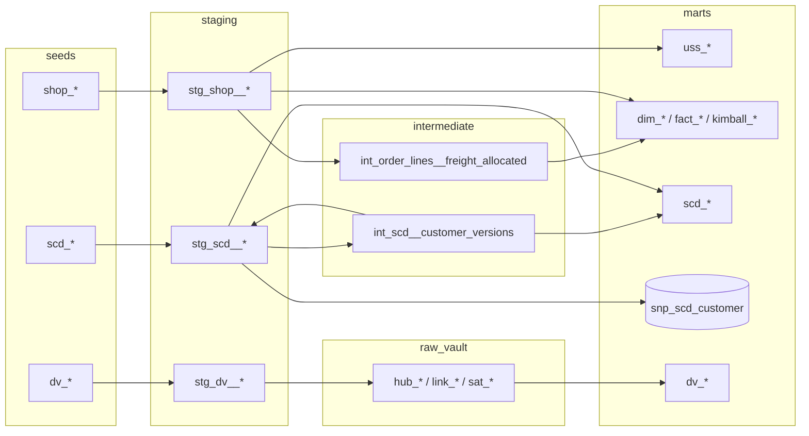

# dbt project: all four topics as a tested pipeline

The SQL examples in the topic folders are scripts you run by hand. This folder
rebuilds the same four models as a [dbt](https://docs.getdbt.com/) project on
DuckDB, the way a data engineering team would ship them: layered models,
incremental loads, a snapshot, and tests that prove the numbers are right.

| Topic | dbt models |
|-------|-----------|
| [Unified Star Schema](../unified-star-schema/README.md) | `uss_bridge` (built as `_bridge`), `uss_customer_totals`, `uss_product_totals`, `uss_products_never_sold` |
| [Kimball star](../kimball-star-schema/README.md) | `dim_customer`, `dim_product`, `dim_date`, `fact_order_line`, `fact_order`, `fact_shipment`, `kimball_customer_totals`, `kimball_monthly_totals` |
| [Slowly Changing Dimensions](../slowly-changing-dimensions/README.md) | `scd_dim_customer_type1/2/6`, `scd_fact_sales`, `scd_sales_by_city`, snapshot `snp_scd_customer` |
| [Data Vault 2.0](../data-vault/README.md) | incremental `hub_*`, `link_*`, `sat_*`; marts `dv_dim_*`, `dv_fact_*`, `dv_customer_totals`, `dv_customer_history` |

## Quick start

```sh
cd dbt-project
python -m venv .venv && source .venv/bin/activate
pip install -r requirements.txt
./run_dbt.sh                       # build + test everything, 3 simulated runs
dbt docs generate --profiles-dir . && dbt docs serve --profiles-dir .   # lineage graph
```

`profiles.yml` is in this folder and writes to `data_modelling_basics.duckdb`
(override with `DBT_DUCKDB_PATH`).

## Project layout

```
dbt-project/
├── seeds/                 CSV source data (shop, scd, data_vault)
├── models/
│   ├── staging/           1:1 with sources: rename, cast; DV hash keys + hash diffs
│   ├── intermediate/      reusable logic: freight allocation, SCD version detection
│   ├── raw_vault/         Data Vault hubs, links, satellites (incremental, insert-only)
│   └── marts/             what users query, one folder per topic
├── snapshots/             snp_scd_customer: dbt-native SCD Type 2
├── macros/                hash_key / hash_diff
├── tests/
│   ├── generic/           custom reusable tests
│   └── assert_*.sql       business invariants
├── analyses/              fan_trap.sql, chasm_trap.sql (wrong on purpose)
└── run_dbt.sh             the full build, as CI runs it
```

## Lineage



`dbt docs serve` shows the full, model-by-model version of this graph.

## The three simulated runs

Real pipelines run every day against a source that changes. `run_dbt.sh`
simulates that with two [vars](https://docs.getdbt.com/docs/build/project-variables):

| run | `extract_no` (Data Vault) | `scd_as_of` (snapshot) | what must happen |
|-----|--------------------------|------------------------|------------------|
| 1 | 1 | 2024-02-01 | vault loads Acme (Milan) and order 100; snapshot sees Milan/Turin |
| 2 | 1 again | 2024-04-01 | vault inserts **nothing** (idempotent); snapshot closes Milan, opens Rome |
| 3 | 2 | 2024-06-01 | vault adds order 101 and one new `sat_customer` row (Rome); snapshot adds Florence and Gamma |

Final snapshot, identical to the SQL-built `scd_dim_customer_type2`:

| customer_id | city | dbt_valid_from | dbt_valid_to |
|--:|--|--|--|
| 1 | Milan | 2024-01-01 | 2024-03-01 |
| 1 | Rome | 2024-03-01 | |
| 2 | Turin | 2024-01-01 | 2024-05-01 |
| 2 | Florence | 2024-05-01 | |
| 3 | Naples | 2024-05-01 | |

Raw vault row counts after run 3: 1 customer, 2 order and 3 product hubs;
2 + 4 link rows; 2 / 3 / 2 / 4 satellite rows. The information mart reports
freight 15 and amount 140, matching extract 2.

## Incremental models (Data Vault)

`raw_vault/` models are `materialized: incremental` with no `unique_key`: they
only ever append. On an incremental run, `` adds:

- **hubs and links**: `where <hash key> not in (select <hash key> from {{ this }})`
- **satellites**: a join to the latest stored row per key, keeping only rows
  whose `hash_diff is distinct from` it.

So re-running the same extract inserts zero rows, and an unchanged customer
never gets a new satellite row.

## Tests

`dbt build` runs **3 unit tests** and **119 data tests**; models downstream of a
failing test are skipped.

| Kind | Examples | What it protects |
|------|----------|------------------|
| Generic (built-in) | `unique`, `not_null`, `relationships`, `accepted_values` | keys, referential integrity, bridge `stage` values |
| Generic (custom, `tests/generic/`) | `unique_combination_of_columns`, `no_overlapping_intervals`, `no_consecutive_duplicates` | composite keys, SCD intervals, satellite change detection |
| Singular (`tests/assert_*.sql`) | bridge totals = source totals; USS and Kimball agree with each other and with the source; allocated freight sums to order freight; one current version per customer; every sale finds exactly one version; DV mart = current extract | the business rules of each topic |
| Unit (dbt ≥ 1.8) | freight allocation 2/3/5; rounding remainder (3.34 + 3.33 + 3.33); SCD skips no-op changes | transformation logic on hand-written inputs |

The tests were checked by breaking the models on purpose:

| Bug introduced | Caught by |
|----------------|-----------|
| bridge copies order freight onto each line | `assert_uss_bridge_preserves_source_totals` |
| SCD keeps no-op change-log rows as versions | unit test `scd_versions_skip_no_op_changes` |
| satellite loses its change detection | `unique_combination_of_columns` and `no_consecutive_duplicates` on `sat_customer` |

## The traps, as analyses

`analyses/` holds the wrong queries from the topic READMEs. They compile but
are never built:

```sh
dbt show --select fan_trap --profiles-dir .     # freight 30 instead of 10
dbt show --select chasm_trap --profiles-dir .   # 60 / 200 / 36 instead of 10 / 100 / 12
```

## CI

[`.github/workflows/ci.yml`](../.github/workflows/ci.yml) runs on every push:

- **sql-examples**: every topic's `run.sh` on DuckDB and on a PostgreSQL 16
  service container.
- **dbt**: `./run_dbt.sh`, then `dbt docs generate`; the docs site is uploaded
  as the `dbt-docs` build artifact.

On every push to `main`, [`pages.yml`](../.github/workflows/pages.yml) builds
and tests the project again and publishes the docs at
<https://enricoconvento98.github.io/data-modelling-basics/dbt-docs/>.

dbt docs is built for desktop (`.app { min-width: 960px }`), so the deploy
inlines [`docs_mobile/`](docs_mobile/) into the page: below 960px the content
uses the full width, the model tree becomes a drawer behind a **Models**
button, and the lineage graph opens full screen. Desktop is unchanged.
