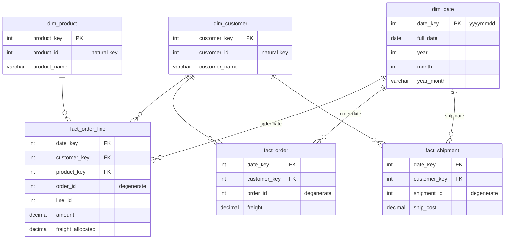

# Kimball Star Schema

The dimensional modelling approach of Ralph Kimball (*The Data Warehouse
Toolkit*). Measurements go into **fact tables**; the context used to filter
and group them (who, what, when) goes into **dimension tables**. Each fact
table is joined directly to its dimensions, forming a star.

This topic uses **the same five source tables and data** as the
[Unified Star Schema](../unified-star-schema/README.md) topic, so you can
compare how each approach avoids the fan and chasm traps.

- [Facts, dimensions and grain](#facts-dimensions-and-grain)
- [The model](#the-model)
- [Rule 1: one grain per fact table (fan trap)](#rule-1-one-grain-per-fact-table-fan-trap)
- [Rule 2: never join facts to facts — drill across (chasm trap)](#rule-2-never-join-facts-to-facts--drill-across-chasm-trap)
- [Conformed dimensions](#conformed-dimensions)
- [Kimball vs. Unified Star Schema](#kimball-vs-unified-star-schema)
- [Other Kimball techniques worth knowing](#other-kimball-techniques-worth-knowing)
- [Running the SQL](#running-the-sql)

## Facts, dimensions and grain

| Concept | Meaning | In this example |
|---------|---------|-----------------|
| **Business process** | Something the business does that produces measurements | ordering, shipping |
| **Grain** | What exactly *one row* of a fact table represents | one order line; one order; one shipment |
| **Fact** | A numeric measurement at that grain | `amount`, `freight`, `ship_cost` |
| **Dimension** | Descriptive context, joined to facts by a key | customer, product, date |
| **Surrogate key** | Meaningless integer key owned by the warehouse | `customer_key`, `product_key` |
| **Degenerate dimension** | A key with no dimension table of its own, kept on the fact | `order_id`, `shipment_id` |

**Declare the grain first.** Every design decision follows from it, and every
fan trap is a violation of it.

## The model

Three fact tables, one per grain, sharing three dimensions
([`sql/02_dimensions.sql`](sql/02_dimensions.sql),
[`sql/03_facts.sql`](sql/03_facts.sql)):



## Rule 1: one grain per fact table (fan trap)

`freight` is measured per **order**, `amount` per **order line**. Put both on
a line-grain fact by copying freight onto every line and you are back to the
fan trap — freight sums to **30**.

There are two correct options, both shown in [`sql/03_facts.sql`](sql/03_facts.sql):

1. **A separate fact table at order grain** (`fact_order`) holding `freight`.
2. **Allocate** the order-level measure down to the line grain, in proportion
   to something sensible (here: `amount`):

| line_id | amount | freight_allocated = 10 × amount / 100 |
|--------:|-------:|--------------------------------------:|
| 1001 | 20 | 2 |
| 1002 | 30 | 3 |
| 1003 | 50 | 5 |
| **total** | **100** | **10** ✅ |

Allocation is a **business rule**, not a technicality: someone has to agree
that freight is split by value (rather than by weight or evenly), and you must
handle rounding so the allocated parts add back up to the original.

## Rule 2: never join facts to facts — drill across (chasm trap)

Joining `fact_order_line` to `fact_shipment` on `customer_key` multiplies
3 lines × 2 shipments → amount **200**, ship_cost **36**.

The Kimball answer is **drill-across**: aggregate each fact table on its own
to the shared (conformed) dimension attributes, *then* join the small results.

```sql
WITH lines AS (SELECT customer_key, SUM(amount)    AS amount    FROM fact_order_line GROUP BY customer_key),
     ords  AS (SELECT customer_key, SUM(freight)   AS freight   FROM fact_order      GROUP BY customer_key),
     ships AS (SELECT customer_key, SUM(ship_cost) AS ship_cost FROM fact_shipment   GROUP BY customer_key)
SELECT c.customer_name, o.freight, l.amount, s.ship_cost      -- 10, 100, 12
FROM dim_customer c
LEFT JOIN lines l ON l.customer_key = c.customer_key
LEFT JOIN ords  o ON o.customer_key = c.customer_key
LEFT JOIN ships s ON s.customer_key = c.customer_key;
```

Each CTE returns one row per customer, so the final joins are one-to-one and
cannot fan out. BI tools generate exactly this pattern when they "stitch"
multiple fact tables.

## Conformed dimensions

Drill-across only works if the facts share **the same** dimension — same keys,
same attribute values. That is a *conformed dimension*. `dim_date` is the
classic one: orders join it on order date, shipments on ship date, and a
month-level report across both processes just works:

| year_month | freight | amount | ship_cost |
|------------|--------:|-------:|----------:|
| 2024-01 | 10 | 100 | 12 |

The list of business processes (rows) × conformed dimensions (columns) is
Kimball's **bus matrix**, the blueprint of an enterprise warehouse:

| Process | Customer | Product | Date |
|---------|:-:|:-:|:-:|
| Order lines | ✔ | ✔ | ✔ (order) |
| Orders | ✔ | | ✔ (order) |
| Shipments | ✔ | | ✔ (ship) |

## Kimball vs. Unified Star Schema

| | Kimball star | Unified Star Schema |
|--|--|--|
| Shape | One star per business process | One star around a single `_bridge` |
| Fan trap | Avoided by **design** (one grain per fact, or allocation) | Avoided by **construction** (measures only on their own stage) |
| Chasm trap | Avoided at **query** time (drill-across) | Avoided by construction (no table-to-table joins) |
| Freight by product | Possible, via an agreed allocation rule (Widget 7, Gadget 3) | Lands on a `NULL` product (not attributable) |
| "Products never sold" | Dimension anti-join to the fact | A `products` stage row with no line key |
| Main cost | Design effort; queries across processes need drill-across | A wide, long bridge; every table must be added to it |

## Other Kimball techniques worth knowing

- **Slowly changing dimensions** — how dimensions keep history; see
  [slowly-changing-dimensions](../slowly-changing-dimensions/README.md).
- **Fact table types** — transaction (this example), periodic snapshot
  (e.g. month-end balance: not additive over time), accumulating snapshot
  (one row per order, updated as it passes milestones).
- **Unknown member** — a dimension row such as `customer_key = -1, 'Unknown'`
  so facts with missing references are not lost by inner joins.
- **Role-playing dimensions** — one `dim_date` used as order date, ship date,
  due date… through views or aliases.
- **Junk dimensions** — bundle low-cardinality flags into one small dimension
  instead of cluttering the fact table.
- **Bridge tables** — for genuine many-to-many relationships (e.g. accounts ↔
  holders), with weighting factors to avoid double counting.

## Running the SQL

```sh
./run.sh                                                   # DuckDB, in-memory
for f in sql/0*.sql; do psql -v ON_ERROR_STOP=1 -f "$f"; done   # PostgreSQL
```

| script | purpose |
|--------|---------|
| [`01_source_tables.sql`](sql/01_source_tables.sql) | Source tables (same as the USS topic) |
| [`02_dimensions.sql`](sql/02_dimensions.sql) | `dim_customer`, `dim_product`, `dim_date` with surrogate keys |
| [`03_facts.sql`](sql/03_facts.sql) | `fact_order_line` (with allocated freight), `fact_order`, `fact_shipment` |
| [`04_queries.sql`](sql/04_queries.sql) | Wrong mixed-grain and fact-to-fact queries; correct drill-across; by product; never sold |
