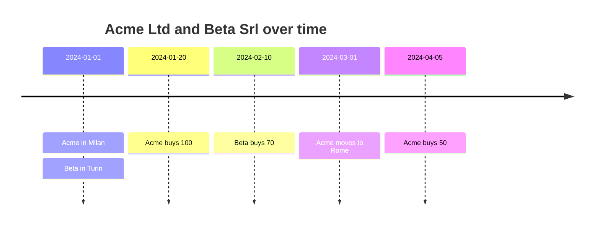
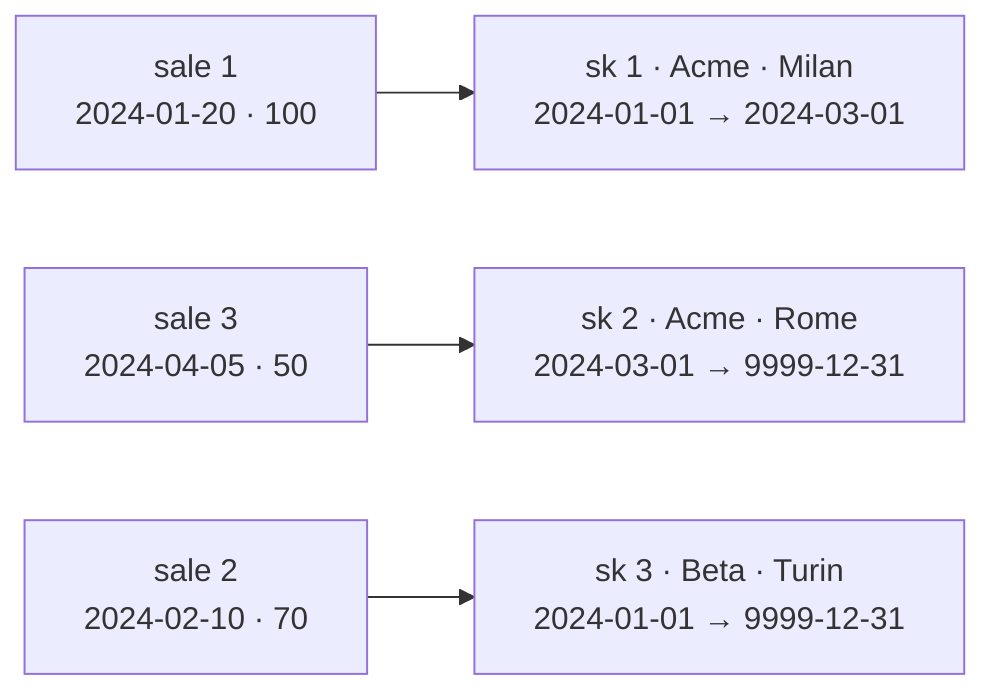

# Slowly Changing Dimensions (SCD)

Dimension attributes change: customers move, products are renamed, sales reps
change region. A **slowly changing dimension** technique decides what happens
to history when they do. The choice changes the numbers in your reports, so it
is a business decision as much as a technical one.

- [The scenario](#the-scenario)
- [Type 0 — retain original](#type-0--retain-original)
- [Type 1 — overwrite](#type-1--overwrite)
- [Type 2 — add a new row](#type-2--add-a-new-row)
- [Type 3 — add a new column](#type-3--add-a-new-column)
- [Type 6 — hybrid (1 + 2 + 3)](#type-6--hybrid-1--2--3)
- [Maintaining Type 2 incrementally](#maintaining-type-2-incrementally)
- [Choosing a type](#choosing-a-type)
- [Pitfalls](#pitfalls)
- [Running the SQL](#running-the-sql)

## The scenario

[`sql/01_source.sql`](sql/01_source.sql):



The question every report asks: **sales by city**. Should Acme's January sale
count for Milan (where the customer was) or Rome (where the customer is now)?

## Type 0 — retain original

The attribute never changes after it is first loaded (e.g. original credit
score, date of birth). Not implemented here: it is just "ignore updates".

## Type 1 — overwrite

[`sql/02_type1.sql`](sql/02_type1.sql). Keep one row per customer, overwrite
changed attributes.

| customer_id | customer_name | city |
|--:|--|--|
| 1 | Acme Ltd | **Rome** |
| 2 | Beta Srl | Turin |

| city | amount |
|------|-------:|
| Rome | **150** |
| Turin | 70 |

Simple and small, but **history is rewritten**: the January sale now looks like
a Rome sale. Last month's report, re-run today, gives different numbers. Good
for corrections (a typo in a name) and attributes nobody analyses historically.

## Type 2 — add a new row

[`sql/03_type2.sql`](sql/03_type2.sql). Every change creates a new **version**
with its own surrogate key and a validity interval.

| customer_sk | customer_id | city | valid_from | valid_to | is_current |
|--:|--:|--|--|--|--|
| 1 | 1 | Milan | 2024-01-01 | 2024-03-01 | false |
| 2 | 1 | Rome  | 2024-03-01 | 9999-12-31 | true |
| 3 | 2 | Turin | 2024-01-01 | 9999-12-31 | true |

The key idea: **the fact row points to the version valid when the event
happened**. The lookup is done once, at load time:

```sql
JOIN dim_customer_t2 d
  ON d.customer_id = s.customer_id
 AND s.sale_date >= d.valid_from
 AND s.sale_date <  d.valid_to          -- half-open interval [from, to)
```



Now a plain join gives history **as it was**:

| city | amount |
|------|-------:|
| Milan | 100 |
| Rome | 50 |
| Turin | 70 |

Things to notice:

- **Count customers with the natural key**: `COUNT(DISTINCT customer_id)` = 2,
  while there are 3 rows (versions).
- **"As of" queries** are a filter on the interval: on 2024-02-15 Acme was in
  Milan.
- `valid_to = 9999-12-31` (instead of `NULL`) keeps range predicates simple.
- Only *tracked* attributes create versions; others can be Type 1 in the same
  table.

## Type 3 — add a new column

[`sql/04_type3_type6.sql`](sql/04_type3_type6.sql). One row per customer, with
the previous value in its own column:

| customer_id | current_city | previous_city |
|--:|--|--|
| 1 | Rome | Milan |
| 2 | Turin | |

Useful for "before / after a reorganisation" comparisons. It keeps **only one**
step of history and cannot tell you which value applied on which date.

## Type 6 — hybrid (1 + 2 + 3)

Type 2 rows, plus a `current_city` column that is overwritten (Type 1) on
**every** version of the customer:

| customer_sk | customer_id | city (historical) | current_city |
|--:|--:|--|--|
| 1 | 1 | Milan | Rome |
| 2 | 1 | Rome | Rome |
| 3 | 2 | Turin | Turin |

The same fact table can now answer both questions without any extra join:

| perspective | city | amount |
|-------------|------|-------:|
| historical (`city`) | Milan / Rome / Turin | 100 / 50 / 70 |
| current (`current_city`) | Rome / Turin | 150 / 70 |

## Maintaining Type 2 incrementally

In production a Type 2 dimension is not rebuilt; each batch of source changes
is **merged** in two steps ([`sql/05_type2_incremental.sql`](sql/05_type2_incremental.sql)):

1. **Expire** the current version of each customer whose tracked attributes
   changed (`valid_to = new effective date`, `is_current = false`).
2. **Insert** a new current version for every batch row that now has no current
   version — which covers both changed and brand-new customers.

Batch effective 2024-05-01: Beta → Florence (new version), Acme unchanged
(no new version), Gamma SpA new (first version). A later Beta sale picks the
Florence version, while Beta's February sale stays in Turin:

| city | amount |
|------|-------:|
| Florence | 30 |
| Milan | 100 |
| Rome | 50 |
| Turin | 70 |

Running the same batch again changes nothing: the merge is **idempotent**.
Many engines offer `MERGE` for this; the two-statement form above works
everywhere.

## Choosing a type

| Type | History | Rows | Typical use |
|------|---------|------|-------------|
| 0 | Original value forever | 1 per member | Attributes that must never change |
| 1 | None | 1 per member | Corrections; attributes not analysed over time |
| 2 | Full | 1 per version | Default for attributes that drive analysis (region, segment, price list) |
| 3 | One previous value | 1 per member | Planned one-off changes (re-territorialisation) |
| 6 | Full + current | 1 per version | Users need both "as was" and "as is" |

## Pitfalls

- **Joining Type 2 on the natural key** (`customer_id`) instead of the
  surrogate key duplicates every fact once per version — a fan trap.
- **Late-arriving changes** (a change effective in the past) require splitting
  an existing interval and re-pointing facts.
- **Overlapping or gapped intervals** break the point-in-time lookup; test that
  each date matches exactly one version.
- **Rapidly changing attributes** (e.g. age band, balance band) make Type 2
  explode; move them to a separate "mini-dimension".
- **Source timestamps vs. load timestamps**: decide whether `valid_from` is
  when the change happened in the business or when the warehouse saw it.
  [Data Vault](../data-vault/README.md) keeps the load timestamp and derives
  the rest.

## Running the SQL

```sh
./run.sh                                                   # DuckDB, in-memory
for f in sql/0*.sql; do psql -v ON_ERROR_STOP=1 -f "$f"; done   # PostgreSQL
```

| script | purpose |
|--------|---------|
| [`01_source.sql`](sql/01_source.sql) | Customer change log and sales |
| [`02_type1.sql`](sql/02_type1.sql) | Type 1: overwrite, sales by current city |
| [`03_type2.sql`](sql/03_type2.sql) | Type 2: versions, point-in-time fact lookup, "as of" query |
| [`04_type3_type6.sql`](sql/04_type3_type6.sql) | Type 3 (previous value) and Type 6 (historical + current) |
| [`05_type2_incremental.sql`](sql/05_type2_incremental.sql) | Incremental Type 2 merge, idempotent re-run |
