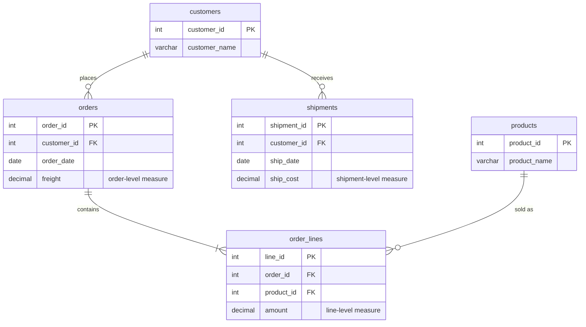
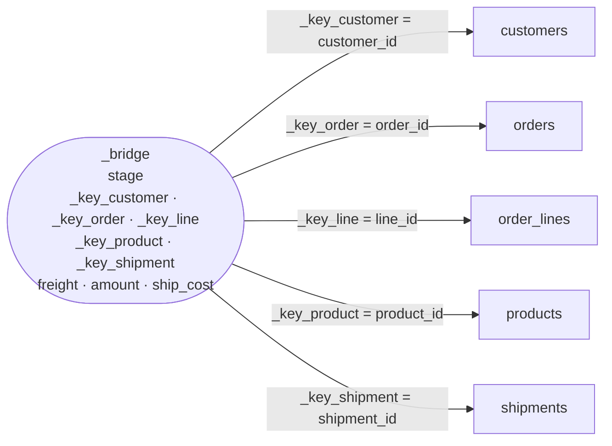

# Unified Star Schema (USS)

The Unified Star Schema is a modelling pattern described by Francesco Puppini
and Bill Inmon in *The Unified Star Schema* (2020). Instead of designing a
separate star per business process, it puts **one bridge table** — the
**Puppini Bridge** (`_bridge`) — in the centre, and connects **every** table
directly to it. Queries never join one source table to another, so the classic
**fan trap** and **chasm trap** cannot happen.

- [The source model](#the-source-model)
- [The problem: fan trap](#the-problem-fan-trap)
- [The problem: chasm trap](#the-problem-chasm-trap)
- [The Puppini Bridge](#the-puppini-bridge)
- [Querying the USS](#querying-the-uss)
- [Worked example: bridge rows](#worked-example-bridge-rows)
- [Trade-offs](#trade-offs)
- [Running the SQL](#running-the-sql)

## The source model

Five tables, defined in [`sql/01_source_tables.sql`](sql/01_source_tables.sql):



Sample data: one customer (*Acme Ltd*) with **1 order** (freight 10),
**3 order lines** (amounts 20 + 30 + 50 = 100), **2 shipments**
(ship costs 5 + 7 = 12), and a product (*Gizmo*) that has **never been sold**.

The correct totals are therefore: **freight = 10, amount = 100, ship_cost = 12**.

## The problem: fan trap

A **fan trap** happens when a measure lives on the "one" side of a
one-to-many join. Joining `orders → order_lines` repeats the order row once per
line, so the order-level `freight` is summed three times:

| order_id | freight | line_id | amount |
|---------:|--------:|--------:|-------:|
| 100 | 10 | 1001 | 20 |
| 100 | 10 | 1002 | 30 |
| 100 | 10 | 1003 | 50 |
| **total** | **30** ❌ | | **100** ✅ |

## The problem: chasm trap

A **chasm trap** happens when two independent one-to-many relationships hang
off the same table: `shipments ← customers → orders`. Orders and shipments are
unrelated to each other, so joining both to the customer produces their
cartesian product:

| customer | order_id | freight | shipment_id | ship_cost |
|----------|---------:|--------:|------------:|----------:|
| Acme Ltd | 100 | 10 | 501 | 5 |
| Acme Ltd | 100 | 10 | 502 | 7 |
| **total** | | **20** ❌ | | **12** |

Add the order lines as well and you get 3 × 2 = 6 rows per customer:
freight **60**, amount **200**, ship_cost **36** — everything is wrong. See
[`sql/02_naive_joins.sql`](sql/02_naive_joins.sql).

## The Puppini Bridge

The bridge is built as a `UNION ALL` of one **stage** per source table
([`sql/03_bridge.sql`](sql/03_bridge.sql)). For each stage:

1. **One row per row of the source table** — the `stage` column says which
   table it came from.
2. The row carries **its own key** plus **every key reachable by following
   many-to-one links**. An order line knows its order, and through the order,
   its customer; it also knows its product. Following many-to-one links can
   never multiply rows, so this is safe.
3. **Measures appear only on their own stage.** `freight` is filled only on
   `orders` rows, `amount` only on `order_lines` rows, `ship_cost` only on
   `shipments` rows. Everything else is `NULL`.

| stage | own key | keys reached via many-to-one | measures |
|-------|---------|------------------------------|----------|
| `customers` | `_key_customer` | — | — |
| `orders` | `_key_order` | `_key_customer` | `freight` |
| `order_lines` | `_key_line` | `_key_order`, `_key_customer`, `_key_product` | `amount` |
| `products` | `_key_product` | — | — |
| `shipments` | `_key_shipment` | `_key_customer` | `ship_cost` |

Because every measure exists in exactly one row per source row, summing a
measure over any set of bridge rows can never double-count it.

### Every table joins only to `_bridge`

The resulting model is a single star: the bridge in the centre, the five tables
around it, each joined on **its own key** with `_bridge LEFT JOIN table`.



Each table is on the "one" side of its join to the bridge, so a `LEFT JOIN`
from the bridge never adds rows. The table only *decorates* bridge rows with
attributes (names, dates, ...).

## Querying the USS

See [`sql/04_uss_queries.sql`](sql/04_uss_queries.sql). Every query starts
`FROM _bridge` and left-joins the tables it needs.

**Totals by customer** — correct: freight 10, amount 100, ship_cost 12.

```sql
SELECT c.customer_name,
       SUM(b.freight)   AS freight,
       SUM(b.amount)    AS amount,
       SUM(b.ship_cost) AS ship_cost
FROM _bridge b
LEFT JOIN customers c ON c.customer_id = b._key_customer
WHERE c.customer_id IS NOT NULL
GROUP BY c.customer_name;
```

**Totals by product** — amounts split by product; freight and ship cost are
not attributable to a product, so they appear once on the `NULL` product row
instead of being duplicated:

| product_name | amount | freight | ship_cost |
|--------------|-------:|--------:|----------:|
| Gadget | 30 | 0 | 0 |
| Gizmo | 0 | 0 | 0 |
| Widget | 70 | 0 | 0 |
| (no product) | 0 | 10 | 12 |

**Products never sold** — every product has a row on the `products` stage, so
it is in the bridge even without any order line:

```sql
SELECT p.product_id, p.product_name
FROM _bridge b
LEFT JOIN products p ON p.product_id = b._key_product
WHERE b._key_product IS NOT NULL
GROUP BY p.product_id, p.product_name
HAVING COUNT(b._key_line) = 0;     -- → 3, Gizmo
```

## Worked example: bridge rows

The full `_bridge` for the sample data (empty cells are `NULL`):

| stage | _key_customer | _key_order | _key_line | _key_product | _key_shipment | freight | amount | ship_cost |
|-------|--:|--:|--:|--:|--:|--:|--:|--:|
| customers   | 1 |     |      |   |     |       |       |      |
| orders      | 1 | 100 |      |   |     | 10.00 |       |      |
| order_lines | 1 | 100 | 1001 | 1 |     |       | 20.00 |      |
| order_lines | 1 | 100 | 1002 | 2 |     |       | 30.00 |      |
| order_lines | 1 | 100 | 1003 | 1 |     |       | 50.00 |      |
| products    |   |     |      | 1 |     |       |       |      |
| products    |   |     |      | 2 |     |       |       |      |
| products    |   |     |      | 3 |     |       |       |      |
| shipments   | 1 |     |      |   | 501 |       |       | 5.00 |
| shipments   | 1 |     |      |   | 502 |       |       | 7.00 |
| **sum**     |   |     |      |   |     | **10.00** | **100.00** | **12.00** |

Read it column by column: filtering on `_key_customer = 1` picks up the order,
the three lines and both shipments — each measure exactly once.

## Trade-offs

- **Wide bridge.** The bridge has one key column per table and one column per
  measure, and one row per row of *every* table. With many tables it becomes
  wide and long; columnar engines handle this well (most columns are `NULL`
  and compress to almost nothing), row stores less so.
- **Many-to-many relationships.** Stages only follow many-to-one links. A
  genuine many-to-many (e.g. products ↔ categories) cannot be flattened into a
  single row without multiplying rows; it has to be resolved with its own
  associative table/stage and a deliberate choice of how measures are
  allocated.
- **Date handling.** Each table has its own date (`order_date`, `ship_date`).
  A shared "calendar" dimension needs a single date key on the bridge, so
  each stage must decide which of its dates populates `_key_date` (or the
  bridge carries several role-playing date keys). Questions like "shipments
  and orders per month" only work once that choice is made.
- **Not-applicable rows.** Grouping by an attribute that a stage cannot reach
  (product for freight) produces a `NULL` group. That is correct — the value
  is not attributable — but users need to understand it.
- **Key design.** This example uses plain integer keys. In practice USS
  bridges often use text keys (e.g. prefixed or composite business keys) so
  that keys from different sources never collide.
- **Maintenance.** The bridge must be rebuilt (or incrementally maintained)
  whenever any source table changes, and every new table means a new stage and
  new columns.

## Running the SQL

With the DuckDB CLI (in-memory database by default, or pass a file name):

```sh
./run.sh            # in-memory
./run.sh uss.duckdb # persist to a file
```

With PostgreSQL:

```sh
for f in sql/0*.sql; do psql -v ON_ERROR_STOP=1 -f "$f"; done
```

| script | purpose |
|--------|---------|
| [`01_source_tables.sql`](sql/01_source_tables.sql) | Create and populate the 5 source tables |
| [`02_naive_joins.sql`](sql/02_naive_joins.sql) | Show inflated totals from the fan and chasm traps |
| [`03_bridge.sql`](sql/03_bridge.sql) | Build `_bridge` as a `UNION ALL` of stages |
| [`04_uss_queries.sql`](sql/04_uss_queries.sql) | Correct totals by customer and product; products never sold |
